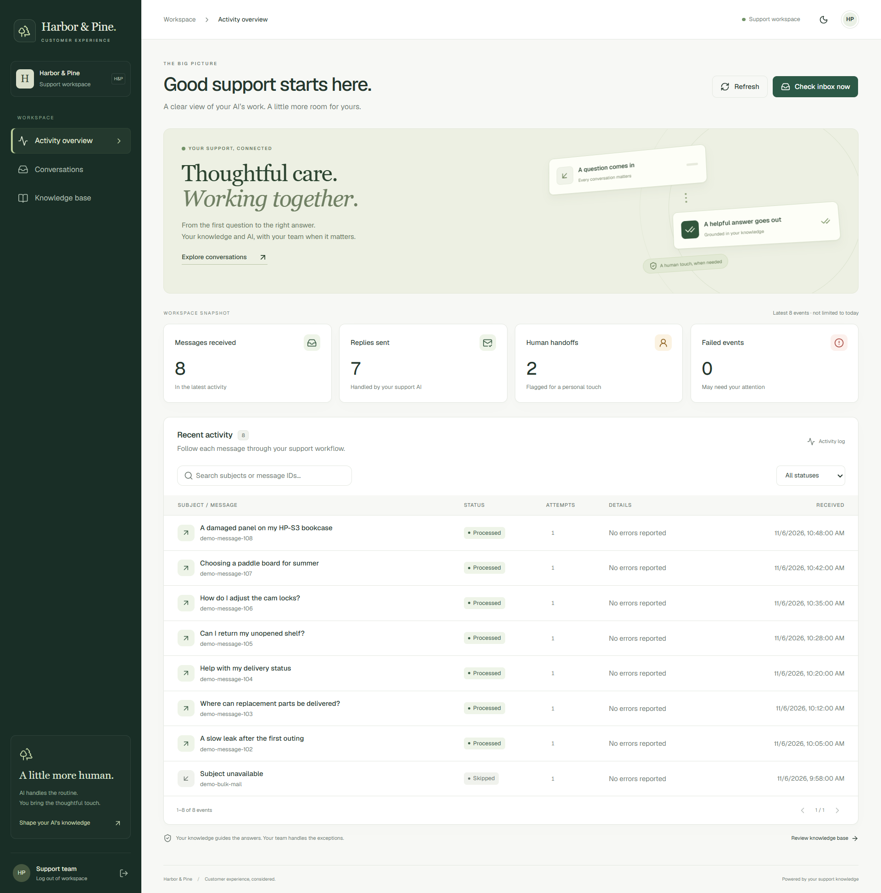
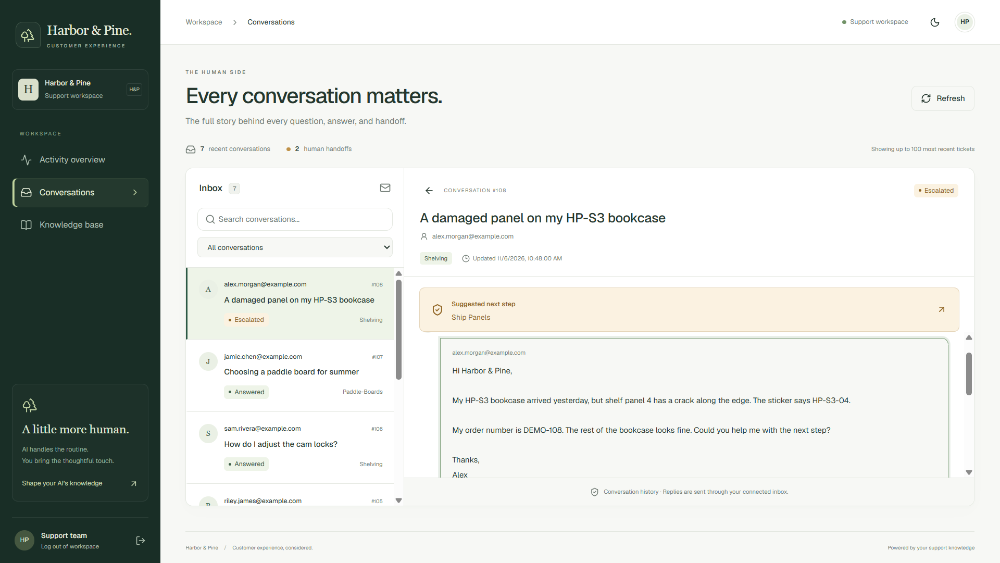
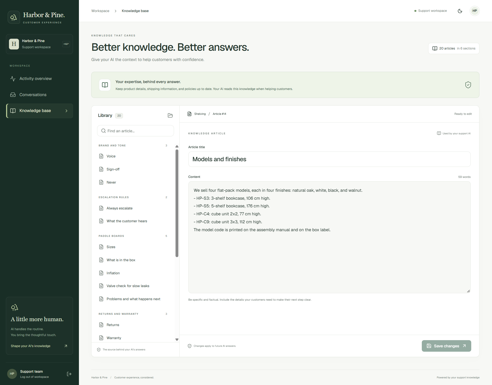
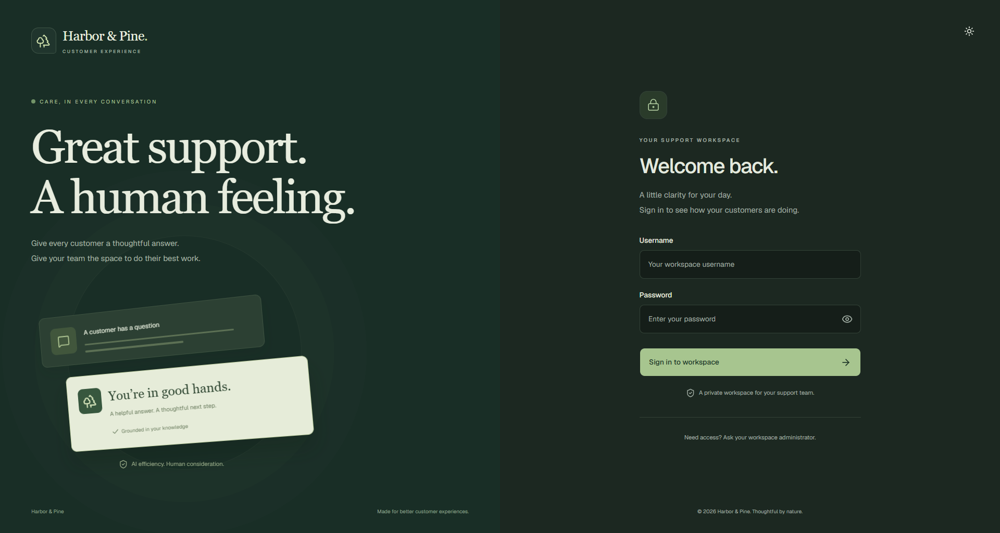
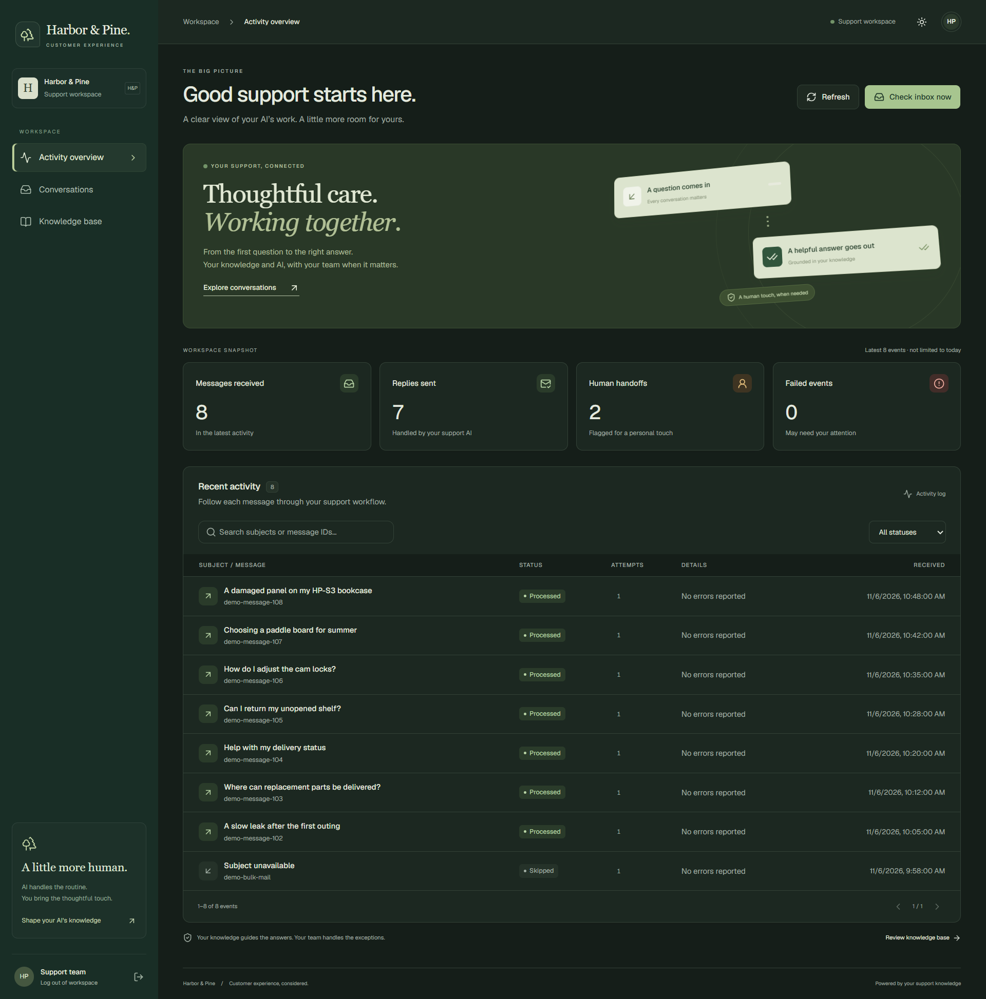
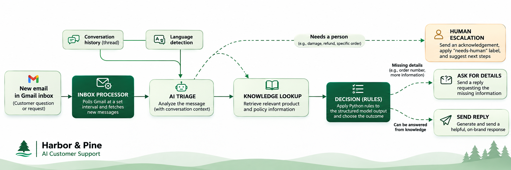
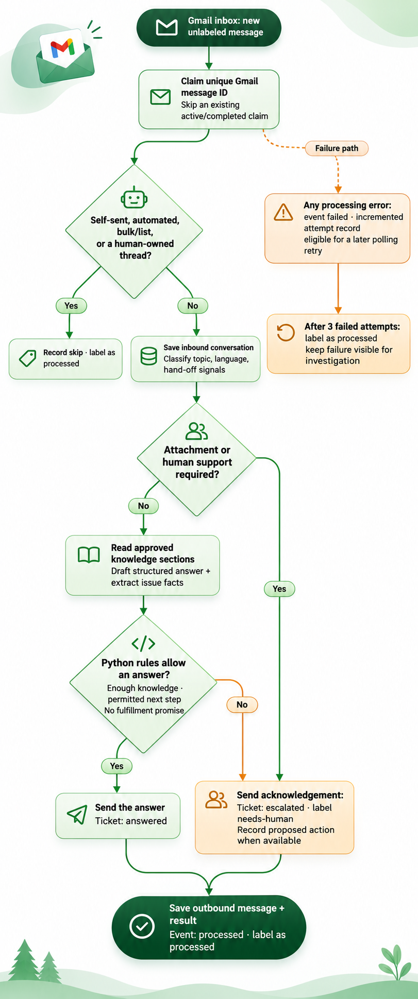
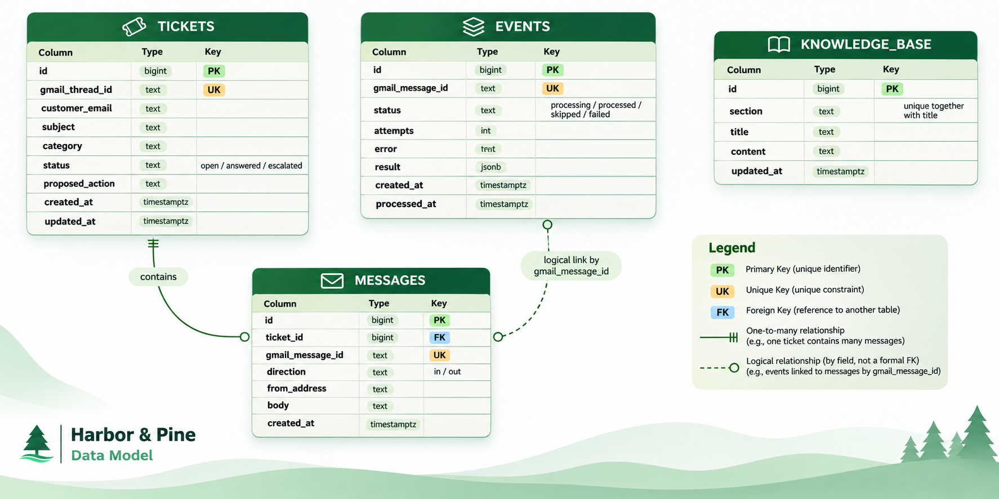

# Harbor & Pine · AI Customer Support

**An email support workspace that connects customer questions, business knowledge, and human judgment.**

A full-stack application for a fictional home and outdoor retailer. It reads a connected Gmail inbox, classifies customer messages, looks up approved product and policy information, and either sends a helpful reply or hands the conversation to a person. A React dashboard brings the activity log, conversation history, and knowledge editor into one workspace.

<p>
  
  
  
  
  
</p>



*Actual application screenshots, captured locally with synthetic demonstration conversations. The numbers illustrate the interface; they are not business performance results.*

[The problem](#the-problem) · [Product tour](#product-tour) · [Architecture](#architecture) · [Workflow](#from-inbox-to-outcome) · [Run locally](#run-locally) · [Tests](#testing-and-evaluation) · [Technical notes](docs/RUNBOOK.md)

## The problem

Small retail support teams repeatedly answer the same questions about products, assembly, shipping, and returns. Finding the right policy takes time, while requests involving damage, refunds, or a specific order need a different level of care.

The challenge is deciding **which questions can be answered from available knowledge, which details are missing, and when a person should take over**—while keeping the conversation visible to the team.

This application brings those steps together. It is designed to reduce repeated lookup and triage work, make routine answers more consistent, and give colleagues enough context to handle exceptions. Those are intended benefits; no customer ROI or response-time improvement is claimed.

## What the application does

| Capability | What a support team can do |
|---|---|
| Connected email intake | Process new Gmail messages on a polling interval or request an inbox check from the dashboard. |
| Context-aware triage | Classify the latest message using the conversation thread, detect its language, and identify requests that need human support. |
| Knowledge-based answers | Let the support agent read relevant product information, brand guidelines, and escalation policies through database-backed tools. |
| Application-controlled decisions | Apply Python rules to structured model output before choosing a reply or a handoff. |
| Human escalation | Send an acknowledgement, apply a `needs-human` Gmail label, and retain a suggested next step where available. |
| Activity visibility | Search by subject or message ID, filter statuses, inspect failures and attempts, and jump to the exact saved message. |
| Conversation history | Read inbound messages, outbound replies, categories, statuses, and proposed actions in a two-pane workspace. |
| Knowledge maintenance | Review and edit existing articles, with save feedback and protection against accidentally discarding changes. |
| Responsive workspace | Use light or dark mode, keyboard navigation, a mobile drawer, and reduced-motion behavior. |

## Product tour

### Activity overview

See recent processing outcomes alongside counts of received messages, completed replies, human handoffs, and failures. The event table uses email subjects rather than internal event numbers. Its leading icon opens the related conversation and highlights the matching message.

The snapshot covers the **latest 100 events**, not a daily total or an all-time analytics report. Events without a saved ticket retain their processing record and show “Subject unavailable.”

### Conversations and human handoffs



Read the customer’s original message beside the support response. Search conversations by subject, customer address, or category, then filter by ticket status. Activity links can open a ticket even when it is outside the latest 100 conversations.

Human follow-up happens in Gmail. The dashboard provides a **read-only conversation history**; it does not include a manual reply composer, ticket reassignment, or a fulfillment approval button.

### Knowledge base



The AI’s product and policy information lives in editable PostgreSQL records, grouped into sections. Updating an article changes the knowledge available to subsequent agent runs, without changing the application code.

The included domain covers paddle boards, shelving, shipping, returns and warranty, brand tone, and escalation rules. Retrieval reads complete named sections through tools; this implementation does not use a vector database or embeddings.

<details>
<summary><strong>Sign-in and dark theme</strong></summary>





</details>

## Architecture



The system has two entry points into the same processing logic: a background polling process and the dashboard’s authenticated manual-check endpoint. FastAPI serves the API and, after a frontend build, the dashboard assets. Supabase provides the PostgreSQL database; the browser reaches support data through FastAPI rather than connecting directly to the database.

| Layer | Technology | Responsibility |
|---|---|---|
| Support workspace | React, TypeScript, Vite | Activity, conversations, article editing, navigation, and UI states. |
| Design system | Tailwind CSS, Radix UI, shadcn/ui, Lucide, Geist | Reusable controls, typography, responsive layouts, and themes. |
| API | FastAPI, Pydantic Settings | Authenticated routes, configuration, and static dashboard delivery. |
| Email | Gmail API, Google OAuth 2.0 | Inbox queries, thread retrieval, plain-text replies, and labels. |
| AI orchestration | Pydantic AI | Typed classification, knowledge tools, structured drafts, and validation. |
| Model provider | Groq | Configurable classifier and support-agent model inference. |
| Business logic | Python | Escalation checks and product-specific next-step decisions. |
| Persistence | PostgreSQL / Supabase, psycopg | Events, tickets, message history, and knowledge articles. |
| Verification | unittest, Vitest, Testing Library, Pydantic Evals | Offline regressions, UI interactions, and live model evaluations. |

The configured default model IDs are `groq:openai/gpt-oss-20b` for classification and `groq:qwen/qwen3.8-27b` for drafting. They are settings, not a requirement to hard-code a provider’s current catalog; a selected replacement must support the output and tool-calling behavior used by its agent.

## From inbox to outcome

<details>
<summary><strong>View the complete decision-flow diagram</strong></summary>



</details>

1. **Find and claim a message.** The worker queries inbox mail without the `ai-processed` label. A unique Gmail message ID records the claim and prevents the usual repeated-poll path from processing an already claimed message again.
2. **Apply email guards.** Self-sent messages, automatic responses, and bulk/list mail are skipped. Once a thread is marked `needs-human`, the bot leaves subsequent follow-up to the colleague handling it.
3. **Save the conversation.** The application creates or updates the ticket, stores the inbound message, and reads the Gmail thread for context.
4. **Classify the request.** The first agent returns a typed topic, language, human-support flag, reason, and acknowledgement. Attachments and early handoff conditions bypass answer drafting.
5. **Read knowledge and draft.** The second agent calls tools for the brand voice, escalation rules, and relevant knowledge sections, then returns a typed draft and extracted issue facts.
6. **Apply Python decisions.** The application checks knowledge sufficiency, escalation requests, proposed fulfillment steps, and action promises. It chooses either a customer reply or an acknowledgement plus handoff.
7. **Send and record.** Gmail sends the selected text. The application saves the outbound message and decision, updates the ticket, applies labels, and records the event outcome.

### Example: a damaged shelving panel

> “Panel 4 of my HP-S3 arrived cracked. The part number is HP-S3-04, and I have my order number.”

The classifier routes the request to shelving. The support agent reads the relevant guidance and extracts the damaged-part facts. Python determines that a one-panel replacement requires a colleague, records `ship-panels` as the proposed action, and chooses a handoff acknowledgement. The system **does not place a replacement order or promise shipment**.

Other examples include answering assembly guidance, asking for missing order or part details, suggesting a valve check for a slow leak, and escalating refund requests or specific delivery investigations.

## Engineering decisions

- **Typed contracts between stages.** Pydantic schemas separate classification, draft content, extracted product facts, and the final decision. The classifier uses native structured output; the support agent validates a prompted structured response separately from knowledge-tool calls.
- **Rules outside the model.** Product thresholds and allowed next steps live in Python. For example, one or two damaged shelving panels suggest individual parts, while three or more suggest a full replacement; arranging either requires a human.
- **Bounded request recovery.** The model wrapper handles transient failures and provider reset hints within attempt, wait, and elapsed-time budgets. SDK retries are disabled to avoid multiplying attempts.
- **Controlled knowledge reads.** A per-run record prevents repeated full-section results from bloating the context. The support agent also has an eight-request limit.
- **Operational traceability.** Event status, attempt count, error text, and structured results stay separate from ticket and message history. Support staff can investigate an outcome without treating a model response as the system’s entire state.
- **Usable failure states.** Data-loading failures, sign-in errors, save failures, and inbox-check failures receive visible feedback. Stale conversation requests are cancelled when the user changes tickets.

## Data model



| Record | Purpose |
|---|---|
| `events` | One processing record per Gmail message ID, including attempts, error, timestamps, and decision JSON. |
| `tickets` | One support ticket per Gmail thread, with customer, subject, category, status, and proposed action. |
| `messages` | Inbound and outbound plain-text messages belonging to a ticket. |
| `knowledge_base` | Sectioned articles, unique by section and title, read by the agent and edited through the API. |

`messages.ticket_id` is a foreign key. Activity-to-message navigation uses a logical join on the unique `gmail_message_id`; that relationship is not a database foreign key.

## Run locally

### Requirements

- Python **3.13+** and `uv`.
- Node.js compatible with Vite 8; **Node 22.12+ or a supported newer release** is a suitable starting point.
- A dedicated Gmail inbox with Gmail API OAuth credentials.
- A PostgreSQL database; the included schema targets Supabase.
- A Groq API key and model access compatible with the selected agents.

### 1. Install and configure

From the repository root:

```powershell
uv sync
Copy-Item .env.example .env
```

Fill in `.env` with your own values. The required integration settings are:

```dotenv
GOOGLE_CLIENT_ID=your-google-client-id
GOOGLE_CLIENT_SECRET=your-google-client-secret
GOOGLE_REFRESH_TOKEN=your-google-refresh-token
DATABASE_URL=your-postgresql-connection-string
GROQ_API_KEY=your-groq-key
DASHBOARD_USERNAME=admin
DASHBOARD_PASSWORD=choose-a-private-password
```

Create an OAuth desktop client with Gmail API access, save its downloaded JSON as `credentials.json`, and run `uv run python scripts/get_refresh_token.py` to authorize your demo inbox. The helper prints credential values for your local `.env`; keep that terminal output private. More configuration and troubleshooting are in the [runbook](docs/RUNBOOK.md).

### 2. Create the tables and load knowledge

Apply [`supabase/migrations/20261104180138_create_tables.sql`](supabase/migrations/20261104180138_create_tables.sql) through the Supabase SQL editor or your migration workflow. Then run:

```powershell
uv run python -m scripts.seed_knowledge_base
```

This upserts the bundled Markdown articles into the configured database. Re-running it can overwrite dashboard edits with the file contents, so use it deliberately.

### 3. Start the API and dashboard

Terminal one, from the repository root:

```powershell
uv run fastapi dev app/main.py
```

Terminal two:

```powershell
cd dashboard
npm ci
npm run dev
```

Open the Vite URL printed in the terminal, usually `http://localhost:5173`, and sign in using your dashboard credentials. The frontend proxies `/api` to `http://127.0.0.1:8000`.

### 4. Check integrations, then enable polling

```powershell
# Reads the configured knowledge sections and Gmail profile; sends no email.
uv run python -m app.preflight

# Optional: exercises the real AI pipeline and database without sending email.
uv run python -X utf8 playground/try_pipeline.py

# Starts live inbox processing and can send customer replies.
uv run python -m app.poller
```

Use **one polling process per inbox**. The dashboard’s “Check inbox now” also runs live processing; avoid overlapping manual checks and background polling. For automatic development restarts on Windows:

```powershell
uv run watchfiles "uv run python -m app.poller" app .env
```

The inner `uv run` keeps the child process in the project’s Python environment.

### Explore the UI without external accounts

After installing and building the dashboard:

```powershell
cd dashboard
npm ci
npm run build
cd ..
python scripts/showcase_server.py
```

Open `http://localhost:4178`. This **local, read-only showcase** uses synthetic conversations and the bundled knowledge articles. It does not load `.env`, contact external services, send email, or persist edits. It demonstrates the interface, not a live AI run. Use `http://localhost:4178/?signed-out=1` to view the sign-in screen.

## Testing and evaluation

Run the offline backend regression tests from the repository root:

```powershell
uv run python -m unittest discover -s tests -v
```

Check the dashboard from `dashboard/`:

```powershell
npm run lint
npm test
npm run build
```

These checks cover retry behavior, Gmail transport configuration, activity navigation, authentication, and dashboard interactions. They use test doubles and do not send customer email. Live model evaluation requires configured integrations; see the [runbook](docs/RUNBOOK.md) for commands and operational limits.
